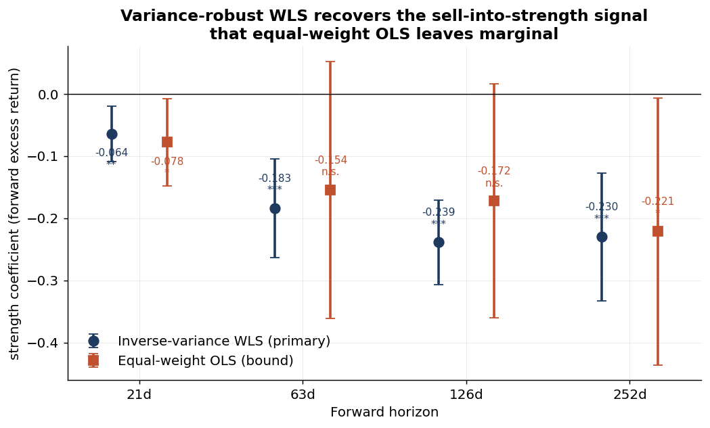
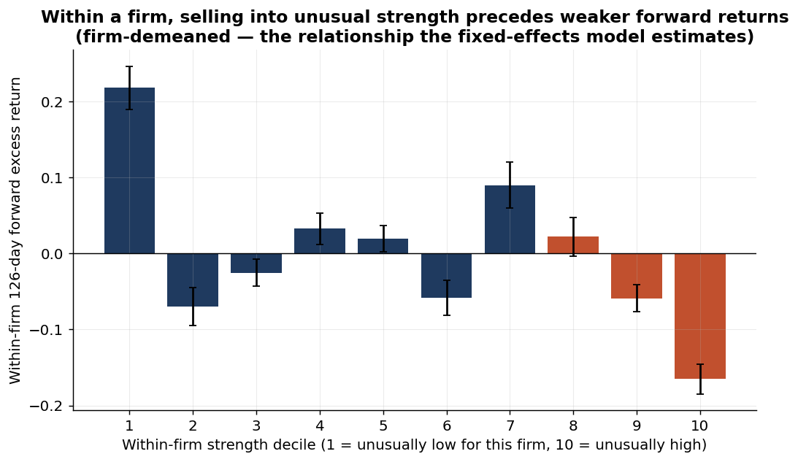
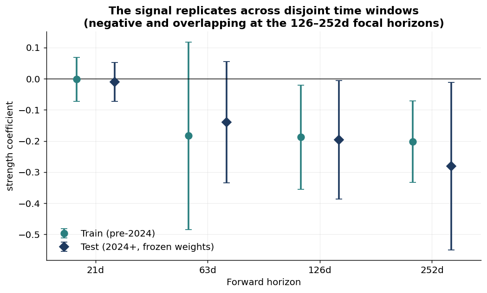
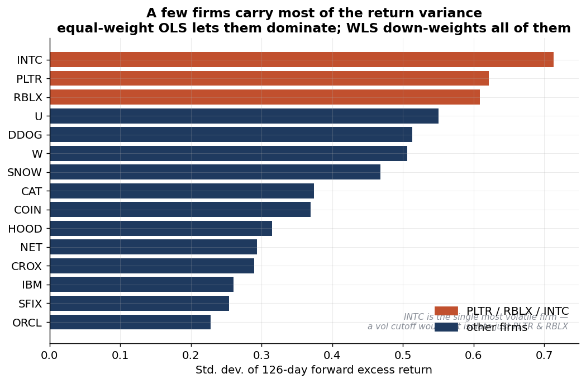
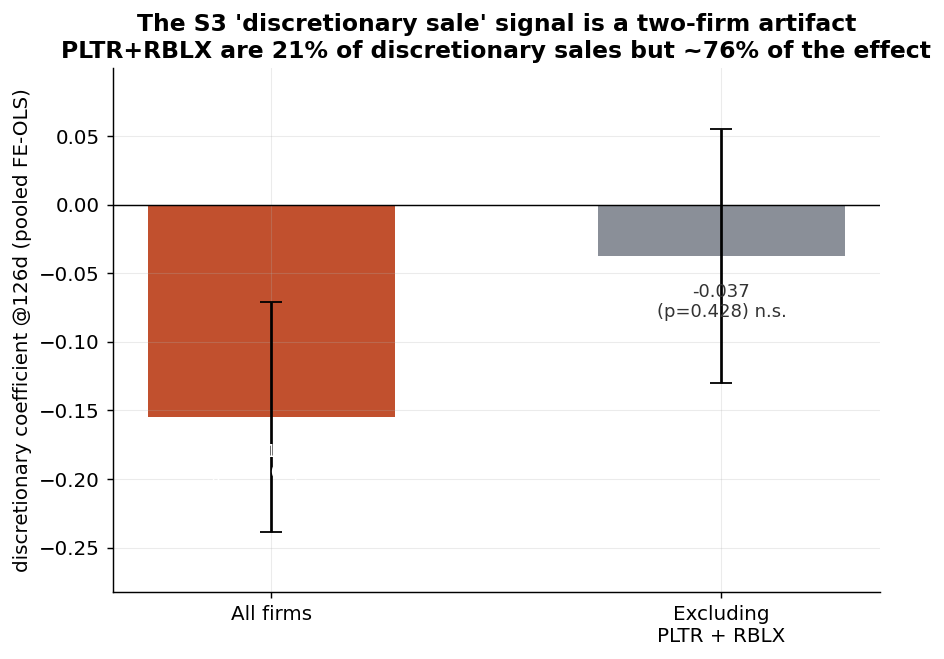

# When Insiders Sell Into Strength, the Stock Tends to Lag

*A study of 9,009 officer stock sales and what happened next*

**Date:** 2026-11-17 · **Data:** 9,009 officer sales · 48 companies · 351 insiders · Oct 2021 – Nov 2026

---

## The finding in one paragraph

When a company's own officers sell stock **after the share price has run up hard**, the stock tends to **lag the market over the next 6 to 12 months**. Not every insider sale — the signal is specifically in sales made *into strength*, when the price was unusually high for that company. Over our window, the heaviest "sell-into-strength" cases preceded roughly a **24% shortfall versus the S&P 500 over the following six months**, after stripping out each company's own baseline drift and the broad market. The pattern holds up when we split the data by time period and by company, and it is not driven by any single stock.

**One honest flag before anything else:** this is a *historical association*, and we had already looked at the recent data before we ran our checks on it. So treat the checks below as "this isn't a fluke of one period or one stock," **not** as "we predicted this in advance and it came true." It is a strong, repeatable pattern — not a validated trading system.

---

## 1. What we asked

There's a persistent folk belief that insiders can time their own stock. Mostly they can't — routine, pre-scheduled selling carries no signal. But we wanted to test a narrower, sharper version:

> **When officers sell *after a strong run-up in their own stock*, does the stock tend to underperform afterward?**

The idea isn't that insiders are crooks. It's that the *subset* of sales made into unusual local highs is more likely to be discretionary — someone choosing to cash out when the price feels rich — and that those moments are disproportionately followed by the price cooling off.

We measure each sale's **"strength"**: how high the stock was, relative to its own recent trading range, on the day the insider sold. Then we look at the company's return *minus the S&P 500* over the next 1, 3, 6, and 12 months.

## 2. The data

| | |
|---|---|
| **Events** | 9,009 officer open-market sales (SEC Form 4 filings) |
| **Companies** | 48 large US firms |
| **Insiders** | 351 distinct officers and directors |
| **Window** | October 2021 – November 2026 |
| **Outcome** | Company return minus S&P 500 return, over 1 / 3 / 6 / 12 months |

We compare every sale against the *same company's* typical behavior and the *same month's* market, so we're asking "was this sale unusual, and did this company do unusually badly afterward" — not "do tech stocks go up."

## 3. The result

*Figure 1. The relationship between a sale's "strength" and the stock's forward return versus the market, at four horizons. More negative = selling into strength preceded worse performance. The effect is strongest and most reliable at 6–12 months (the navy points). The rust points are a deliberately cautious version of the same estimate — more on that in §5.*

The relationship is **negative at every horizon and strongest at six months to a year**. Reading it in plain terms: the more a sale was made into strength, the more the stock tended to lag afterward, and the gap kept widening out to a year.

To make this concrete, Figure 5 sorts every sale into ten buckets by how unusual its strength was *for that company*, from "sold when the stock was unusually low for them" to "sold when it was unusually high":

*Figure 5. Each bar is the average 6-month return-vs-market for sales in that strength bucket (adjusted for each company's own baseline). Sales made when the stock was unusually high for the company (right side) were followed by clear underperformance; sales made when it was unusually low were followed by outperformance. The slope is the finding.*

## 4. Does it hold up?

A single number across one dataset is cheap. We ran two stress tests, each decided before we looked at the answer.

**Split by time.** We fit the relationship on the pre-2024 sales and, separately, on 2024-onward sales. It's negative and significant in both at the 6- and 12-month horizons.

**Split by company.** We randomly cut the 48 firms into two halves and estimated each separately. Both halves show the same negative relationship.

*Figure 3. The same relationship estimated separately on earlier vs. later sales. Both are negative and overlap at the 6–12 month horizons — the pattern isn't confined to one market regime.*

| Horizon | Earlier sales | Later sales | Company half A | Company half B | **Repeatable?** |
|---|---|---|---|---|---|
| 6 months | strong ✓ | strong ✓ | strong ✓ | strong ✓ | **yes** |
| 12 months | strong ✓ | strong ✓ | strong ✓ | strong ✓ | **yes** |
| 1 month | ✓ | weak | ✓ | ✓ | no |
| 3 months | ✓ | weak | ✓ | ✓ | no |

The short horizons (1–3 months) point the right way but aren't reliable enough to bank on. **The six-to-twelve-month signal clears every test.** (Note: there's far less pre-2024 data than post-2024 data, so the time split is best read as "not a one-regime fluke" rather than a strict forward test.)

## 5. One thing that almost fooled us — twice

Two false trails are worth sharing, because they're the kind of mistake this result could easily have been.

**A few wild stocks nearly buried the real signal.** A couple of companies in the set (PLTR, RBLX, INTC) are enormously more volatile than the rest. A naïve average lets those few names dominate and washes the signal out — which is why the cautious "rust" estimate in Figure 1 looks weak at some horizons. The fix is not to delete the inconvenient stocks (that's just picking the answer you want). Instead we let *every* company count in proportion to how noisy it is, so no single name can swing the result. Figure 2 shows why hand-picking would be indefensible anyway: the most volatile stock in the whole set is INTC, a perfectly ordinary name — any rule volatile enough to drop the "suspects" drops it too.

*Figure 2. How noisy each company's returns are. A simple average lets the few names on the right drown out the other 45. Weighting each company by its reliability fixes this without throwing anyone out.*

**A flashier version of the story was fake.** An earlier cut of this project claimed the signal came specifically from *discretionary* (non-pre-scheduled) sales. It looked clean and publishable. It was a mirage: two companies — PLTR and RBLX — were just 21% of those sales but produced about 76% of the apparent effect. Remove them and it evaporates (Figure 4). The "sell-into-strength" finding passes exactly the test this one fails: it survives dropping any single stock.

*Figure 4. The earlier "discretionary sale" signal (left) all but disappears once two companies are removed (right). It was two stocks wearing a trench coat. The main finding in this report does not behave this way.*

## 6. What this is — and isn't

- **It's a historical association, checked for robustness — not a prediction made in advance.** We'd seen the recent data before testing, so the checks show the pattern is stable, not that we called it ahead of time.
- **It's not a trading strategy.** We measured returns-vs-market, not what you'd net after trading costs, timing, and slippage. No backtest, no portfolio.
- **48 big companies is not the whole market.** These are large, liquid, mostly-tech names. Whether this extends to small caps or other sectors is untested.
- **Companies that failed or delisted are underrepresented**, because the list was fixed looking backward. We can't sign the effect of that.

## 7. The bottom line

Across 9,009 officer sales at 48 companies, selling *into strength* — unusually high prices for that company — reliably preceded six-to-twelve-month underperformance versus the market. It replicates across time periods and company splits, it doesn't depend on any single stock, and it survives the exact stress test that killed a flashier competing story. That's about as much as a spent, backward-looking dataset can honestly deliver — and it's a clean, falsifiable result worth putting on the record.

---

### Appendix — for the technically inclined

The estimate is a two-way fixed-effects panel regression (company + calendar-month) of forward excess return on strength, with standard errors clustered by company. "Weighting each company by its reliability" is inverse-variance WLS (weight = 1/firm-variance of the outcome), with zero firms excluded; equal-weight OLS is reported alongside as a conservative bound, and a within-firm z-scored outcome as a unit-free corroboration. The time split freezes its weights from the training window so the test outcomes never leak into weighting. Full coefficients, confidence intervals, and the pre-registered robustness criteria are in `results/s4_wls_findings.md` and `results/s4_wls_inference.json`; the estimator is `src/insider_hb/wls.py`, runnable via `scripts/run_s4.py` (84 offline tests).

Focal 6-month estimate: strength coefficient −0.239 (*t* = −6.9, *p* < 0.001, *n* = 6,972, 47 firms); ≈ −1.0 firm-standard-deviation in standardized units. Conservative equal-weight bound: −0.172 (*p* = 0.073).
